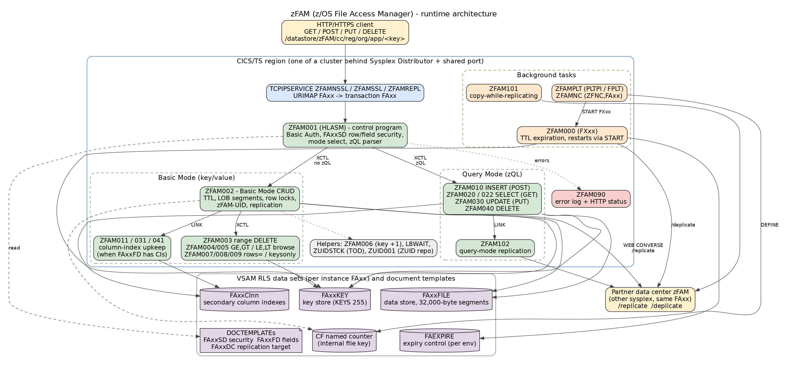

# zFAM architecture

This page describes what the code on `master` does today. It is drawn from the sources in [`Source/`](../Source) and the jobs in [`JCL/`](../JCL); program names below are the CICS program names (`Source/<name>.cbl` or `.asm`).

Diagram source: [`diagrams/architecture.dot`](diagrams/architecture.dot) (Graphviz). Re-render the PNG and SVG with [`diagrams/render.sh`](diagrams/render.sh).

## What zFAM is

zFAM is a key/value store that runs as a set of CICS/TS programs on z/OS. Clients reach it over HTTP or HTTPS. Each client application gets its own *instance* (`FA##`, for example `FA01`), which is a set of CICS resources plus VSAM data sets. Many CICS regions in a Parallel Sysplex serve the same instance behind a shared port and Sysplex Distributor, and the data sets are opened in VSAM RLS mode so every region sees the same data.

## Request path

1. **TCPIPSERVICE.** `ZFAMNSSL` (HTTP), `ZFAMSSL` (HTTPS) and `ZFAMREPL` (replication) listen on the ports set in `Source/CONFIG.txt` (`Source/CSDZFAMN.rdo`, `CSDZFAMS.rdo`, `CSDZFAMR.rdo`).
2. **URIMAP.** Per instance, `Source/CSDFA##.rdo` maps:

   | Path | Transaction | Program | Purpose |
   |---|---|---|---|
   | `/datastore/zFAM/<cc>/<reg>/<org>/<app>*` | `FA##` | `ZFAM001` | Client CRUD |
   | `/replicate/zFAM/...` | `FR##` | `ZFAM001` | Writes from the partner data center |
   | `/deplicate/zFAM/...` | `FD##` | `ZFAM001` | Expiry deletes from the partner data center |
   | `/zComplete/zFAM/...`, `/zRecovery/zFAM/...` | `FZ##` | `ZFAM100` | Defined in the CSD; no `ZFAM100` source is in this repo |

3. **`ZFAM001` (HLASM), control program.** Performs Basic Authentication, reads the instance's document templates (`FA##SD` security, `FA##FD` field definitions), and applies row and field level security. Plain HTTP is only allowed for GET when the read-only option is enabled. If the query string (GET/DELETE) or body (POST/PUT) holds zQL, the request is **Query Mode**; otherwise it is **Basic Mode**. It then `XCTL`s to the service program, passing the parsed request in a channel.
4. **Service programs** do the VSAM I/O and send the HTTP response. Errors from any program are `LINK`ed to **`ZFAM090`**, which writes the error log and returns the HTTP status (see [http_response_codes.md](../http_response_codes.md)).

### Basic Mode (key/value)

| Program | Language | Role |
|---|---|---|
| `ZFAM002` | COBOL | POST/GET/PUT/DELETE of one key. Handles TTL (`ttl=` in days, max 36500), large binary objects split into 32,000-byte `FA##FILE` segments (`zFAM-LOB`, `zFAM-Append`), row locking, optional `zFAM-UID` key generation (`LINK ZUID001`), and synchronous replication to the partner data center (`WEB CONVERSE` to `/replicate`). |
| `ZFAM003` | COBOL | DELETE of a key range (`zFAM-RangeBegin` / `zFAM-RangeEnd`). |
| `ZFAM004` / `ZFAM005` | COBOL | GET browse forward (`ge`/`gt`, plus key existence checks) and backward (`le`/`lt`). |
| `ZFAM007` / `ZFAM008` / `ZFAM009` | COBOL | GET browse with `rows=` forward, backward, and forward `keysonly`. |
| `ZFAM011` / `ZFAM031` / `ZFAM041` | COBOL | When `FA##FD` defines column indexes, keep the `FA##CInn` index files in step on POST / PUT / DELETE. |
| `ZFAM006` | HLASM | Called by the browse programs to add one to a 255-byte key. |

`ZFAM002` reaches the browse and range programs by `XCTL` and the column index programs by `LINK`.

### Query Mode (zQL)

| Program | Language | Role |
|---|---|---|
| `ZFAM010` | HLASM | `INSERT` (POST). |
| `ZFAM020` | HLASM | `SELECT` (GET) by primary key. |
| `ZFAM022` | HLASM | `SELECT` (GET) through a secondary column index. |
| `ZFAM030` | HLASM | `UPDATE` (PUT). |
| `ZFAM040` | HLASM | `DELETE`. |
| `ZFAM102` | COBOL | `LINK`ed by the Query Mode writers to replicate the change to the partner data center. |

Field layouts come from the `FA##FD` template; see [howto_define_query_mode.md](../howto_define_query_mode.md) and [example_query_mode.md](../example_query_mode.md).

## Data stores

All are VSAM KSDS, defined per instance by `JCL/DEFFA##.jcl` and `JCL/DEFCI.jcl`, except `FAEXPIRE`, which is one per environment (`JCL/DEFEXPR.jcl`).

| Data set | IDCAMS member | Contents |
|---|---|---|
| `FA##KEY` | `ZFAMKEY` | Client key (up to 255 bytes) to internal file key, TTL and flags. Keys are kept in ascending order, which is what makes the browse options work. |
| `FA##FILE` | `ZFAMFILE` | Value data, stored as one or more segments under the internal key. |
| `FA##CInn` | `ZFAMCI` | Secondary column indexes for Query Mode (64-byte keys). |
| `FAEXPIRE` | `FAEXPIRE` | Expiration control records, one per instance, used to pace and restart the expiry scan. |

The internal file key comes from a coupling facility named counter, created per instance by `ZFAMNC`.

Copybooks and macros used by the programs: `ZFAMFKC`, `ZFAMFFC`, `ZFAMCIC`, `ZFAMHEX` (COBOL) and `ZFAMFKA`, `ZFAMDKA`, `ZFAMDFA`, `ZFAMCIA` (HLASM).

## Background tasks

- **`ZFAMPLT`** (COBOL) runs from the PLTPI at region start, or by transaction `FPLT`. It browses the URIMAPs and starts one expiry task per zFAM instance.
- **`ZFAMNC`** (HLASM, transaction `ZFNC`) creates an instance's named counter and starts its expiry task in the current region.
- **`ZFAM000`** (COBOL, transaction `FX##`) is the expiry task. It serializes with `ENQ` so one region scans at a time, browses `FA##KEY`, deletes expired keys and their `FA##FILE` segments, sends `/deplicate` to the partner data center when replication is configured, records progress in `FAEXPIRE`, and restarts itself with an interval `START`.
- **`ZFAM101`** (COBOL) copies an instance's records to the partner data center while replication is being brought up ("copy while replicating").

## Replication

When the `FA##DC` template names a partner data center (`JCL/FA##DC.jcl`), writes are sent to the partner's `/replicate` path over the `ZFAMREPL` port and expiry deletes to `/deplicate`. That gives the Active/Standby and Active/Active modes in the [README](../README.md).

## Helpers

| Program | Language | Role |
|---|---|---|
| `L8WAIT` | HLASM | Wait/delay helper. |
| `ZUIDSTCK` | HLASM | Returns the STCKE time-of-day clock. Shared with the ZUID repository. |
| `ZUID001` | - | Unique ID service `LINK`ed for `zFAM-UID`. Lives in the ZUID repository, not here. |

## Build and install

`JCL/CONFIG.jcl` substitutes the values in `Source/CONFIG.txt` into the other members with `Source/REXXREPL.exec`. `JCL/ASMZFAM.jcl` translates, compiles and links every program (`DFHEITAL` for HLASM, `DFHYITVL` for COBOL). `JCL/CSDZFAM*.jcl` define the CSD groups and `JCL/DEFFA##.jcl` defines one instance. Step-by-step instructions are in [Installation.md](../Installation.md).

## Who wrote it

The program headers credit **Rich Jackson** and **Randy Frerking** (Walmart Technology) as the authors of the COBOL and HLASM sources. In this repository's git history, **Michael Karagines** committed the sources, JCL and `Installation.md`; **Trey Vanderpool** wrote `Usage.md`, the examples and the how-to pages; **Rich Jackson** (`rich335z`) wrote the README and system requirements.
