# zFAM migration master plan: COBOL/HLASM on CICS → Java 17 / Spring Boot 3 / PostgreSQL

This plan combines four segment plans. Each was produced by its own child Devin session working in parallel, then reconciled by a coordinator session. The segment docs have the detail: inventories with line numbers, target class and table design, and per-WP acceptance criteria. This file covers the cross-segment view: the dependency graph, delivery phases, ownership decisions and the decisions that are still open.

**Scope:** 28.6k lines (Enterprise COBOL + HLASM + JCL/CSD/IDCAMS) in `Source/` and `JCL/`.
**Target:** Java 17 + Spring Boot 3, PostgreSQL in place of VSAM KSDS/RLS, Spring Security in place of RACF, `@Scheduled` workers in place of CICS started tasks, Maven, and JUnit 5 + Testcontainers.
**Constraint:** the REST contract (URIs, query strings, `zFAM-*` headers, status codes and status text) stays wire-compatible.

## 1. Segments

| Segment | Area | Plan | WPs | Eng-days |
|---|---|---|---|---|
| S1 | Basic Mode | [S1-basic-mode.md](S1-basic-mode.md) ([PR #4](https://github.com/COG-GTM/BAH-COBOL-zFAM/pull/4)) | 13 | 52 |
| S2 | Query Mode / zQL | [S2-query-mode.md](S2-query-mode.md) ([PR #7](https://github.com/COG-GTM/BAH-COBOL-zFAM/pull/7)) | 12 | 45 |
| S3 | Platform & security | [S3-platform.md](S3-platform.md) ([PR #5](https://github.com/COG-GTM/BAH-COBOL-zFAM/pull/5)) | 10 | 47.5 |
| S4 | Replication, data, testing | [S4-replication-data-testing.md](S4-replication-data-testing.md) ([PR #6](https://github.com/COG-GTM/BAH-COBOL-zFAM/pull/6)) | 13 | 62 |
| | **Total** | | **48** | **206.5** |

Estimates are human engineer-days. If work were perfectly parallel, the critical path would be **52 engineer-days** (about 11 weeks):

> S3-WP0 → S2-WP1 → S3-WP1 → S3-WP2 → S3-WP3 → S1-WP3 → S1-WP4 → S4-WP7 → S4-WP10 → S4-WP12

The critical path runs through the platform front door (S3), not the business logic. Staffing S3-WP0 through S3-WP3 early is the main lever on overall duration.

## 2. Delivery phases

| Phase | Goal | WPs | Eng-days | Earliest window (days, unlimited staff) |
|---|---|---|---|---|
| P0 Foundations | Skeleton, codecs, schemas, test harness — unblocks everyone | 12 | 51 | day 0 → 16 |
| P1 Platform & data layer | Front door, auth, IDs, TTL, indexes, data migration tooling | 12 | 56.5 | day 11 → 31 |
| P2 Core API parity | Basic Mode + Query Mode endpoints, wire-compatible | 14 | 58 | day 23 → 44 |
| P3 Replication & hardening | Two-DC replication, CWR, parity suites, perf | 9 | 35 | day 35 → 50 |
| P4 Cutover | Dual-run, reconciliation, cutover/rollback | 1 | 6 | day 46 → 52 |

Phases are gates, not strict waves. A WP can start as soon as its dependencies have merged. Phase P2 cannot be signed off until the S4-WP1/WP2 golden-master suite passes for those endpoints.

## 3. Dependency graph

Colours: blue = S1, green = S2, amber = S3, pink = S4. Thick arrows mark the critical path.

```mermaid
flowchart LR
  subgraph P0["P0 Foundations"]
    S3_WP0["S3-WP0<br/>Project skeleton (Maven, Spring Boot…"]:::s3
    S4_WP4["S4-WP4<br/>zfam-codec (EBCDIC, COMP, COMP-3, AB…"]:::s4
    S1_WP1["S1-WP1<br/>Error catalog + responder (ZFAM090)"]:::s1
    S2_WP1["S2-WP1<br/>Schema model + FAxxFD importer"]:::s2
    S4_WP1["S4-WP1<br/>Golden-master record/replay harness"]:::s4
    S1_WP2["S1-WP2<br/>Key/file store schema + JDBC reposit…"]:::s1
    S2_WP2["S2-WP2<br/>zQL grammar, ZqlParser, AST"]:::s2
    S2_WP3["S2-WP3<br/>FixedRecordCodec + segment math"]:::s2
    S3_WP1["S3-WP1<br/>Instance & security config model (FA…"]:::s3
    S4_WP2["S4-WP2<br/>Contract test catalogue + coverage g…"]:::s4
    S4_WP3["S4-WP3<br/>GnuCOBOL stubbed-CICS oracle harness"]:::s4
    S2_WP6["S2-WP6<br/>Result formatters FIXED/JSON/XML/DELIM"]:::s2
  end
  subgraph P1["P1 Platform & data layer"]
    S2_WP4["S2-WP4<br/>Column index table + SecondaryIndexM…"]:::s2
    S3_WP2["S3-WP2<br/>Front door: routing, limits, mode di…"]:::s3
    S3_WP5["S3-WP5<br/>TodClock, UID generator, PG sequence…"]:::s3
    S4_WP5["S4-WP5<br/>VSAM unload parser/transformer"]:::s4
    S3_WP6["S3-WP6<br/>TTL expiration worker (no-op Deplica…"]:::s3
    S4_WP6["S4-WP6<br/>Loader, CI rebuild, sequence reseed,…"]:::s4
    S3_WP3["S3-WP3<br/>Authentication (Spring Security repl…"]:::s3
    S3_WP7["S3-WP7<br/>Observability, TLS/mTLS listeners, H…"]:::s3
    S3_WP8["S3-WP8<br/>Provisioning API/CLI replacing JCL/C…"]:::s3
    S2_WP5["S2-WP5<br/>Field-level authorizer (FAxxSD Sec f…"]:::s2
    S3_WP4["S3-WP4<br/>Authorization: instance/row-level FA…"]:::s3
    S3_WP9["S3-WP9<br/>Front-door parity test pack"]:::s3
  end
  subgraph P2["P2 Core API parity"]
    S1_WP3["S1-WP3<br/>Basic Mode request parsing"]:::s1
    S1_WP4["S1-WP4<br/>Single-key CRUD non-LOB (ZFAM002)"]:::s1
    S1_WP5["S1-WP5<br/>zFAM-UID / zFAM-Modulo key generation"]:::s1
    S1_WP6["S1-WP6<br/>Row-level locking"]:::s1
    S1_WP7["S1-WP7<br/>LOB append + streaming GET (2 GB)"]:::s1
    S1_WP8["S1-WP8<br/>Single-row browse ge/gt/le/lt (ZFAM0…"]:::s1
    S1_WP9["S1-WP9<br/>Consolidated multi-row browse (ZFAM0…"]:::s1
    S1_WP10["S1-WP10<br/>Range DELETE (ZFAM003)"]:::s1
    S1_WP11["S1-WP11<br/>Column-index hook port (ZFAM011/031/…"]:::s1
    S2_WP7["S2-WP7<br/>QueryModeController, INSERT, replica…"]:::s2
    S2_WP8["S2-WP8<br/>SELECT by primary key (WITH UR/CR)"]:::s2
    S2_WP9["S2-WP9<br/>SELECT by secondary CI, ROWS, stream…"]:::s2
    S2_WP10["S2-WP10<br/>UPDATE with CI maintenance + TTL"]:::s2
    S2_WP11["S2-WP11<br/>DELETE by PK with CI cascade"]:::s2
  end
  subgraph P3["P3 Replication & hardening"]
    S4_WP7["S4-WP7<br/>Replication core: outbox, PartnerCli…"]:::s4
    S1_WP12["S1-WP12<br/>Replication hook wiring (ZFAM002/003…"]:::s1
    S4_WP8["S4-WP8<br/>Query Mode replication (ZFAM102)"]:::s4
    S4_WP9["S4-WP9<br/>Deplication client + DeplicationPort…"]:::s4
    S4_WP10["S4-WP10<br/>CWR copy job (ZFAM101)"]:::s4
    S4_WP11["S4-WP11<br/>Two-DC replication + legacy wire int…"]:::s4
    S4_WP13["S4-WP13<br/>Performance baseline (Gatling)"]:::s4
    S1_WP13["S1-WP13<br/>Basic Mode parity suite"]:::s1
    S2_WP12["S2-WP12<br/>Query Mode parity suite"]:::s2
  end
  subgraph P4["P4 Cutover"]
    S4_WP12["S4-WP12<br/>Dual-run tooling + cutover/rollback …"]:::s4
  end
  S3_WP0 --> S3_WP1
  S2_WP1 ==> S3_WP1
  S3_WP0 --> S3_WP2
  S3_WP1 ==> S3_WP2
  S3_WP2 ==> S3_WP3
  S3_WP3 --> S3_WP4
  S3_WP1 --> S3_WP4
  S2_WP2 --> S3_WP4
  S3_WP1 --> S3_WP5
  S3_WP1 --> S3_WP6
  S3_WP5 --> S3_WP6
  S1_WP2 --> S3_WP6
  S3_WP0 --> S3_WP7
  S3_WP2 --> S3_WP7
  S3_WP6 --> S3_WP7
  S3_WP1 --> S3_WP8
  S3_WP5 --> S3_WP8
  S3_WP6 --> S3_WP8
  S2_WP4 --> S3_WP8
  S3_WP2 --> S3_WP9
  S3_WP3 --> S3_WP9
  S3_WP4 --> S3_WP9
  S4_WP1 --> S3_WP9
  S4_WP2 --> S3_WP9
  S3_WP0 --> S1_WP1
  S1_WP1 --> S1_WP2
  S4_WP4 --> S1_WP2
  S1_WP1 --> S1_WP3
  S3_WP2 --> S1_WP3
  S3_WP3 ==> S1_WP3
  S1_WP2 --> S1_WP4
  S1_WP3 ==> S1_WP4
  S1_WP4 --> S1_WP5
  S3_WP5 --> S1_WP5
  S1_WP4 --> S1_WP6
  S1_WP4 --> S1_WP7
  S1_WP4 --> S1_WP8
  S1_WP8 --> S1_WP9
  S1_WP4 --> S1_WP10
  S1_WP4 --> S1_WP11
  S2_WP4 --> S1_WP11
  S1_WP4 --> S1_WP12
  S1_WP10 --> S1_WP12
  S4_WP7 --> S1_WP12
  S1_WP4 --> S1_WP13
  S1_WP5 --> S1_WP13
  S1_WP6 --> S1_WP13
  S1_WP7 --> S1_WP13
  S1_WP8 --> S1_WP13
  S1_WP9 --> S1_WP13
  S1_WP10 --> S1_WP13
  S1_WP11 --> S1_WP13
  S1_WP12 --> S1_WP13
  S4_WP1 --> S1_WP13
  S4_WP2 --> S1_WP13
  S3_WP0 ==> S2_WP1
  S2_WP1 --> S2_WP2
  S2_WP1 --> S2_WP3
  S2_WP1 --> S2_WP4
  S2_WP3 --> S2_WP4
  S1_WP2 --> S2_WP4
  S2_WP2 --> S2_WP5
  S3_WP1 --> S2_WP5
  S3_WP3 --> S2_WP5
  S2_WP3 --> S2_WP6
  S2_WP2 --> S2_WP7
  S2_WP3 --> S2_WP7
  S2_WP4 --> S2_WP7
  S2_WP5 --> S2_WP7
  S1_WP2 --> S2_WP7
  S3_WP2 --> S2_WP7
  S3_WP5 --> S2_WP7
  S2_WP6 --> S2_WP8
  S2_WP7 --> S2_WP8
  S2_WP4 --> S2_WP9
  S2_WP6 --> S2_WP9
  S2_WP8 --> S2_WP9
  S2_WP4 --> S2_WP10
  S2_WP7 --> S2_WP10
  S2_WP4 --> S2_WP11
  S2_WP7 --> S2_WP11
  S2_WP7 --> S2_WP12
  S2_WP8 --> S2_WP12
  S2_WP9 --> S2_WP12
  S2_WP10 --> S2_WP12
  S2_WP11 --> S2_WP12
  S4_WP1 --> S2_WP12
  S4_WP2 --> S2_WP12
  S3_WP0 --> S4_WP1
  S4_WP1 --> S4_WP2
  S4_WP1 --> S4_WP3
  S4_WP4 --> S4_WP5
  S1_WP2 --> S4_WP5
  S2_WP3 --> S4_WP5
  S4_WP5 --> S4_WP6
  S2_WP4 --> S4_WP6
  S3_WP5 --> S4_WP6
  S1_WP4 ==> S4_WP7
  S3_WP2 --> S4_WP7
  S3_WP1 --> S4_WP7
  S4_WP7 --> S4_WP8
  S2_WP7 --> S4_WP8
  S2_WP10 --> S4_WP8
  S2_WP11 --> S4_WP8
  S4_WP7 --> S4_WP9
  S3_WP6 --> S4_WP9
  S4_WP7 ==> S4_WP10
  S4_WP3 --> S4_WP11
  S4_WP7 --> S4_WP11
  S4_WP8 --> S4_WP11
  S4_WP9 --> S4_WP11
  S4_WP10 --> S4_WP11
  S4_WP2 --> S4_WP12
  S4_WP6 --> S4_WP12
  S4_WP10 ==> S4_WP12
  S4_WP7 --> S4_WP13
  S1_WP4 --> S4_WP13
  S2_WP8 --> S4_WP13
  S2_WP9 --> S4_WP13
  S2_WP10 --> S4_WP13
  S2_WP11 --> S4_WP13
  classDef s1 fill:#dbeafe,stroke:#1d4ed8
  classDef s2 fill:#dcfce7,stroke:#15803d
  classDef s3 fill:#fef3c7,stroke:#b45309
  classDef s4 fill:#fce7f3,stroke:#be185d
```

## 4. Coordinator reconciliation

Each segment session worked without seeing the others, so their first drafts used placeholder cross-segment references and contained two dependency cycles. The coordinator resolved these and sent the fixes back to every child, which then pushed updates to its own PR:

| Issue | Resolution |
|---|---|
| **Cycle:** S4-WP7 (replication core) ⇄ S1-WP12 (replication hooks) | S4-WP7 now depends on S1-WP4 and defines the `ReplicationPort` SPI and the outbox. S1-WP12 only wires the ZFAM002/003 AA/AS hook points into it. |
| **Cycle:** S3-WP6 (TTL worker) ⇄ S4-WP9 (deplication) | S3-WP6 ships a no-op `DeplicationPort`. S4-WP9 implements and wires it. |
| **Ownership overlap:** zQL parsing and Query Mode security both live in ZFAM001.asm (S3's program) | S2-WP2 owns the zQL parser. S3-WP2 only routes on `?zQL`. S3-WP4 consumes the parser output. |
| **Ownership overlap:** FAxxSD authorization appeared in both S2-WP5 and S3-WP4 | S3-WP4 owns instance- and row-level rules. S2-WP5 owns field-level `Sec` flags. Both use the S3-WP1 model. |
| Placeholder deps ("S3 skeleton WP", "S4 parity harness WP", …) | Replaced with real WP IDs (see the table in §6). |

## 5. Cross-cutting decisions

These came up in more than one segment. Each has a provisional recommendation that stakeholders need to sign off.

| # | Decision | Raised by | Provisional recommendation |
|---|---|---|---|
| D1 | **Key collation.** VSAM browses and CI range scans use EBCDIC order, so ASCII/UTF-8 order changes `ge/gt/le/lt`, `rows`, `RangeEnd` and range-delete results | S1 Q1, S2 OQ-1, S4 | Store keys as EBCDIC-ordered `bytea` (or a generated sort column) for parity. Revisit after cutover. |
| D2 | **Unauthenticated `/replicate` and `/deplicate`**, plain-HTTP requests, and "no FAxxSD = full access" | S2 OQ-9, S3, S4 | Don't carry these over. Move replication to a dedicated mTLS listener. Grant explicit exceptions only where an instance needs one. |
| D3 | **Identity store.** RACF password hashes can't be exported | S3 | LDAP/AD bind or an OIDC bridge, rather than re-enrolment. Keep the legacy 401 status-text semantics. |
| D4 | **LOB storage.** Objects can reach about 2 GB, and PostgreSQL `bytea` caps at 1 GB | S1, S4 | Segment rows with streaming receive/send end to end. |
| D5 | **Strict parity vs. improvement.** Legacy behaviour includes ignored partner failures, TTL not forwarded, Query Mode replicating only under AS, and a suspected seconds-vs-days retention bug | S4, S1 Q4, S2 OQ-2/3 | Strict parity first, proven by the golden master. Each fix goes in as a separately flagged follow-up. |
| D6 | **Code vs. docs.** `http_response_codes.md` and Usage.md disagree with the code in places (e.g. 403 01-001 vs 405 05-001; UID in status text vs header) | S1 Q5/Q6, S2 OQ-8 | Treat the code as authoritative. Confirm against recorded production traffic. |
| D7 | **Missing source:** ZFAM100 (`/zComplete`, `/zRecovery`, transaction `FZxx`) is defined in the CSD but not in the repo | S3, S4 | Out of scope until the source is located. |
| D8 | **No mainframe** for golden-master recording | S4 | Use the GnuCOBOL + stubbed-CICS oracle (S4-WP3) for the Basic Mode COBOL. The HLASM paths (ZFAM001/010–040) need a z/OS test LPAR or recorded traffic. |

## 6. All work packages

The **bold** IDs are on the critical path. Start and finish are earliest engineer-days with unlimited staffing.

| WP | Title | Phase | Days | Start | Finish | Depends on |
|---|---|---|---|---|---|---|
| **S3-WP0** | Project skeleton (Maven, Spring Boot 3, Flyway, Testcontainers, CI) | P0 | 4 | 0 | 4 | — |
| S4-WP4 | zfam-codec (EBCDIC, COMP, COMP-3, ABSTIME) | P0 | 3 | 0 | 3 | — |
| S1-WP1 | Error catalog + responder (ZFAM090) | P0 | 3 | 4 | 7 | S3-WP0 |
| **S2-WP1** | Schema model + FAxxFD importer | P0 | 3 | 4 | 7 | S3-WP0 |
| S4-WP1 | Golden-master record/replay harness | P0 | 4 | 4 | 8 | S3-WP0 |
| S1-WP2 | Key/file store schema + JDBC repositories | P0 | 4 | 7 | 11 | S1-WP1, S4-WP4 |
| S2-WP2 | zQL grammar, ZqlParser, AST | P0 | 6 | 7 | 13 | S2-WP1 |
| S2-WP3 | FixedRecordCodec + segment math | P0 | 3 | 7 | 10 | S2-WP1 |
| **S3-WP1** | Instance & security config model (FAxxSD/FAxxDC importers) | P0 | 5 | 7 | 12 | S3-WP0, S2-WP1 |
| S4-WP2 | Contract test catalogue + coverage gate | P0 | 5 | 8 | 13 | S4-WP1 |
| S4-WP3 | GnuCOBOL stubbed-CICS oracle harness | P0 | 8 | 8 | 16 | S4-WP1 |
| S2-WP6 | Result formatters FIXED/JSON/XML/DELIM | P0 | 3 | 10 | 13 | S2-WP3 |
| S2-WP4 | Column index table + SecondaryIndexMaintainer | P1 | 4 | 11 | 15 | S2-WP1, S2-WP3, S1-WP2 |
| S4-WP5 | VSAM unload parser/transformer | P1 | 6 | 11 | 17 | S4-WP4, S1-WP2, S2-WP3 |
| **S3-WP2** | Front door: routing, limits, mode dispatch, error funnel | P1 | 6 | 12 | 18 | S3-WP0, S3-WP1 |
| S3-WP5 | TodClock, UID generator, PG sequences, LockWaiter | P1 | 4.5 | 12 | 16.5 | S3-WP1 |
| S3-WP6 | TTL expiration worker (no-op DeplicationPort) | P1 | 6 | 16.5 | 22.5 | S3-WP1, S3-WP5, S1-WP2 |
| S4-WP6 | Loader, CI rebuild, sequence reseed, reconciliation | P1 | 6 | 17 | 23 | S4-WP5, S2-WP4, S3-WP5 |
| **S3-WP3** | Authentication (Spring Security replacing RACF VERIFY) | P1 | 5 | 18 | 23 | S3-WP2 |
| S3-WP7 | Observability, TLS/mTLS listeners, Helm/compose | P1 | 5 | 22.5 | 27.5 | S3-WP0, S3-WP2, S3-WP6 |
| S3-WP8 | Provisioning API/CLI replacing JCL/CSD/IDCAMS | P1 | 4 | 22.5 | 26.5 | S3-WP1, S3-WP5, S3-WP6, S2-WP4 |
| S2-WP5 | Field-level authorizer (FAxxSD Sec flags) | P1 | 2 | 23 | 25 | S2-WP2, S3-WP1, S3-WP3 |
| S3-WP4 | Authorization: instance/row-level FAxxSD | P1 | 5 | 23 | 28 | S3-WP3, S3-WP1, S2-WP2 |
| S3-WP9 | Front-door parity test pack | P1 | 3 | 28 | 31 | S3-WP2, S3-WP3, S3-WP4, S4-WP1, S4-WP2 |
| **S1-WP3** | Basic Mode request parsing | P2 | 4 | 23 | 27 | S1-WP1, S3-WP2, S3-WP3 |
| S2-WP7 | QueryModeController, INSERT, replication hook SPI | P2 | 5 | 25 | 30 | S2-WP2, S2-WP3, S2-WP4, S2-WP5, S1-WP2, S3-WP2, S3-WP5 |
| **S1-WP4** | Single-key CRUD non-LOB (ZFAM002) | P2 | 8 | 27 | 35 | S1-WP2, S1-WP3 |
| S2-WP10 | UPDATE with CI maintenance + TTL | P2 | 4 | 30 | 34 | S2-WP4, S2-WP7 |
| S2-WP11 | DELETE by PK with CI cascade | P2 | 2 | 30 | 32 | S2-WP4, S2-WP7 |
| S2-WP8 | SELECT by primary key (WITH UR/CR) | P2 | 3 | 30 | 33 | S2-WP6, S2-WP7 |
| S2-WP9 | SELECT by secondary CI, ROWS, streaming, 206 | P2 | 6 | 33 | 39 | S2-WP4, S2-WP6, S2-WP8 |
| S1-WP10 | Range DELETE (ZFAM003) | P2 | 3 | 35 | 38 | S1-WP4 |
| S1-WP11 | Column-index hook port (ZFAM011/031/041) | P2 | 2 | 35 | 37 | S1-WP4, S2-WP4 |
| S1-WP5 | zFAM-UID / zFAM-Modulo key generation | P2 | 2 | 35 | 37 | S1-WP4, S3-WP5 |
| S1-WP6 | Row-level locking | P2 | 4 | 35 | 39 | S1-WP4 |
| S1-WP7 | LOB append + streaming GET (2 GB) | P2 | 6 | 35 | 41 | S1-WP4 |
| S1-WP8 | Single-row browse ge/gt/le/lt (ZFAM004/005/006) | P2 | 3 | 35 | 38 | S1-WP4 |
| S1-WP9 | Consolidated multi-row browse (ZFAM007/008/009) | P2 | 6 | 38 | 44 | S1-WP8 |
| **S4-WP7** | Replication core: outbox, PartnerClient, ReplicationPort SPI | P3 | 6 | 35 | 41 | S1-WP4, S3-WP2, S3-WP1 |
| S2-WP12 | Query Mode parity suite | P3 | 4 | 39 | 43 | S2-WP7, S2-WP8, S2-WP9, S2-WP10, S2-WP11, S4-WP1, S4-WP2 |
| S1-WP12 | Replication hook wiring (ZFAM002/003 AA/AS) | P3 | 2 | 41 | 43 | S1-WP4, S1-WP10, S4-WP7 |
| **S4-WP10** | CWR copy job (ZFAM101) | P3 | 5 | 41 | 46 | S4-WP7 |
| S4-WP13 | Performance baseline (Gatling) | P3 | 3 | 41 | 44 | S4-WP7, S1-WP4, S2-WP8, S2-WP9, S2-WP10, S2-WP11 |
| S4-WP8 | Query Mode replication (ZFAM102) | P3 | 3 | 41 | 44 | S4-WP7, S2-WP7, S2-WP10, S2-WP11 |
| S4-WP9 | Deplication client + DeplicationPort impl | P3 | 3 | 41 | 44 | S4-WP7, S3-WP6 |
| S1-WP13 | Basic Mode parity suite | P3 | 5 | 44 | 49 | S1-WP4, S1-WP5, S1-WP6, S1-WP7, S1-WP8, S1-WP9, S1-WP10, S1-WP11, S1-WP12, S4-WP1, S4-WP2 |
| S4-WP11 | Two-DC replication + legacy wire interop suite | P3 | 4 | 46 | 50 | S4-WP3, S4-WP7, S4-WP8, S4-WP9, S4-WP10 |
| **S4-WP12** | Dual-run tooling + cutover/rollback runbook | P4 | 6 | 46 | 52 | S4-WP2, S4-WP6, S4-WP10 |

## 7. Suggested team shape

With four squads, one per segment, plus a shared platform lead, the plan fits in roughly **14–16 calendar weeks**. That is the critical path plus integration slack.

Devin sessions can run P2's leaf WPs in parallel: S1-WP5 through WP10 and S2-WP8 through WP11 are independent once S1-WP4 and S2-WP7 merge. Each such WP is one PR, gated by the parity suite.
